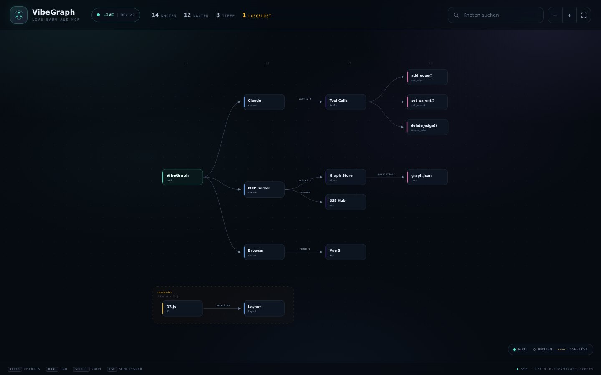
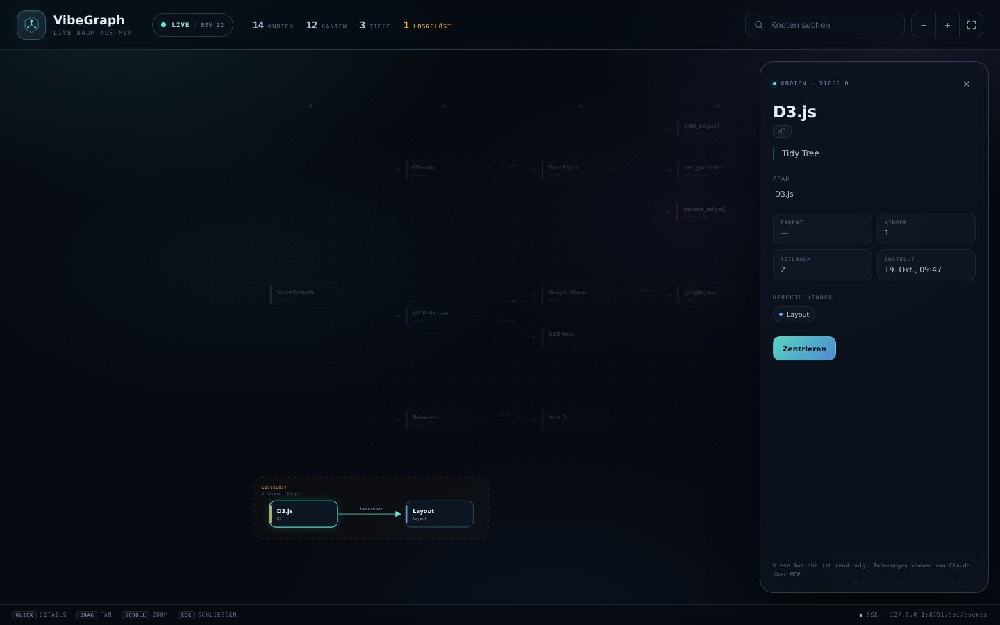

# VibeGraph

Ein kleiner **MCP-Server in Python**, mit dem Claude einen **lebenden, baumförmigen Graphen** aufbaut — und ein **Browser-Fenster**, das jede Änderung sofort mit **Vue 3 + D3.js** zeigt.

- Der **Root ist immer da** und sitzt links. Der Baum wächst nach rechts (wie ein um 90° gedrehter Tree).
- Claude kann Verbindungen hinzufügen, Knoten verschieben und **Verbindungen löschen**.
- Beim Löschen einer Verbindung **bleiben alle Knoten und der komplette dahinterliegende Teilbaum erhalten** — er wird als *losgelöster* Baum in einer gestrichelten Box angezeigt.
- „B gehört zu C“ wird zu einer echten Umhängung: **B wandert mit seinem ganzen Teilbaum unter C**.
- Gespeichert wird in **einer kleinen JSON-Datei** — lesbar, diffbar, backup-freundlich, ohne Datenbank.

```
Claude ──stdio (MCP)──▶ vibegraph-mcp ──schreibt──▶ graph.json
                              │
                              └──HTTP + SSE──▶ Browser (Vue + D3)
```



---

## Schnellstart

```bash
./scripts/setup.sh     # .venv anlegen + Paket installieren
./scripts/demo.sh      # Demo-Graph, ohne Projektdateien anzufassen
```

Dann **http://127.0.0.1:8787** öffnen. Die Demo baut einen kleinen Baum auf, löst eine Verbindung (der Teilbaum bleibt erhalten) und hängt sie wieder an.

### Claude Code

Im Repo liegt bereits eine `.mcp.json`:

```json
{
  "mcpServers": {
    "vibegraph": {
      "command": "${CLAUDE_PROJECT_DIR:-.}/scripts/mcp.sh",
      "args": []
    }
  }
}
```

Claude Code im Projektordner starten, einmal die Server-Freigabe bestätigen (`/mcp`) — fertig. Der Server schreibt nach `graph.json` im Projektordner und startet den Viewer auf Port `8787` (nächster freier Port, falls belegt).

Falls du den Server lieber explizit registrierst:

```bash
claude mcp add vibegraph -- "$PWD/scripts/mcp.sh"
```

### Claude Desktop

Absolute Pfade verwenden (Beispiel anpassen):

```json
{
  "mcpServers": {
    "vibegraph": {
      "command": "/ABSOLUTER/PFAD/vibeitup/.venv/bin/python",
      "args": [
        "-m", "vibegraph",
        "--graph", "/ABSOLUTER/PFAD/vibeitup/graph.json"
      ]
    }
  }
}
```

Nach dem Neustart von Claude Desktop den Viewer öffnen. Jedes Tool-Ergebnis enthält außerdem eine `viewer_url`; `graph_read` liefert sie ebenfalls.

### Beispiel-Graph ansehen

```bash
./.venv/bin/vibegraph-viewer --graph examples/example-graph.json
```

---

## So sprichst du mit Claude

| Du sagst … | Claude ruft auf | Ergebnis |
| --- | --- | --- |
| „a geht zu b“ | `graph_add_edge(source="a", target="b")` | `b` wird Kind von `a`; fehlende Knoten werden angelegt |
| „b gehört zu c“ | `graph_set_parent(node_id="b", parent_id="c")` | `b` wandert mit seinem Teilbaum unter `c` |
| „lösche die Verbindung a → b“ | `graph_delete_edge(source="a", target="b")` | Nur die Kante verschwindet — **alle Knoten bleiben**, der Teilbaum wird losgelöst |
| „lösche Knoten b, aber behalte die Kinder“ | `graph_delete_node(node_id="b")` | Kinder werden an den Parent von `b` gehängt |
| „lösche b und alles darunter“ | `graph_delete_node(node_id="b", mode="cascade")` | Explizit destruktiv: der ganze Teilbaum wird entfernt |
| „was hängt alles unter b?“ | `graph_read(node_id="b")` | Teilbaum, Pfad, Parent, Größe |
| „wo ist nochmal auth?“ | `graph_search(query="auth")` | Treffer in ID, Label und Notiz |

### Die wichtigsten Regeln

- **Ein Baum, keine freie DAG:** Jeder Knoten hat höchstens einen Parent. Zyklen werden abgelehnt.
- **Der Root ist fix:** Er kann nicht Ziel einer Kante, nicht verschoben und nicht gelöscht werden.
- **Kanten löschen ist verlustfrei:** `graph_delete_edge` entfernt niemals Knoten. Der betroffene Teilbaum bleibt als eigener Baum im Graph und wird im Viewer gestrichelt dargestellt. Mit `graph_add_edge` lässt er sich wieder anhängen.
- **Umhängen bewegt den ganzen Teilbaum:** `graph_set_parent` (oder ein `add_edge` auf einen Knoten mit anderem Parent) verschiebt den Knoten samt Nachfahren.
- **IDs sind case-insensitiv eindeutig:** `API` und `api` meinen denselben Knoten; die vorhandene Schreibweise bleibt erhalten.
- **Fehlende Knoten werden von `graph_add_edge` angelegt:** Eine neu erzeugte Quelle hängt zunächst am Root.

Beispiel: Aus

```
root → a → b → c
```

wird nach `graph_delete_edge(source="a", target="b")`

```
root → a          b → c     (losgelöst, aber vollständig erhalten)
```

und nach `graph_add_edge(source="a", target="b")` wieder

```
root → a → b → c
```

---

## MCP-Tools

| Tool | Beschreibung |
| --- | --- |
| `graph_add_edge(source, target, label="")` | Verbindet zwei Knoten. Legt fehlende Knoten an; hängt ein vorhandenes Ziel mit Teilbaum um, falls nötig. |
| `graph_add_node(node_id, label="", note="", parent=null)` | Legt einen Knoten an (idempotent) oder aktualisiert/verschiebt ihn. |
| `graph_set_parent(node_id, parent_id, label="")` | „B gehört zu C“ — hängt den Knoten samt Teilbaum um. |
| `graph_update_node(node_id, label=null, note=null)` | Benennt um oder ändert die Notiz, ohne die Position zu ändern. |
| `graph_delete_edge(source, target)` | Löscht nur die Kante. **Keine Knoten werden gelöscht.** |
| `graph_delete_node(node_id, mode="reparent")` | Löscht einen Knoten; `reparent` behält die Kinder, `cascade` löscht den Teilbaum. |
| `graph_read(node_id=null, max_depth=null)` | Liest den kompletten Baum bzw. einen Teilbaum inkl. losgelöster Bäume, Statistiken und `viewer_url`. |
| `graph_search(query, limit=20)` | Sucht in IDs, Labels und Notizen; liefert Pfad, Tiefe und Teilbaumgröße. |
| `graph_reset(confirm=false)` | Leert den Graphen bis auf den Root; nur mit `confirm=true`. |

Tool-Fehler kommen als saubere MCP-`ToolError`-Meldungen zurück (z. B. bei Zyklen), damit Claude den Aufruf korrigieren kann.

---

## Speicherung: absichtlich leicht

Standarddatei: `./graph.json` (änderbar über `--graph` oder `VIBEGRAPH_GRAPH`). Es gibt keine Datenbank, keinen Server-State und keine externen Dienste.

```json
{
  "schema": 1,
  "revision": 12,
  "updated_at": "2026-10-19T09:47:06Z",
  "root": "root",
  "nodes": [
    {
      "id": "api",
      "label": "API",
      "note": "optional, plain text",
      "created_at": "2026-10-19T09:40:00Z"
    }
  ],
  "edges": [
    {
      "source": "root",
      "target": "api",
      "label": "optional",
      "created_at": "2026-10-19T09:40:00Z"
    }
  ]
}
```

Warum so?

- **Wenige Bytes, sofort verständlich.** Ein typischer Graph bleibt im Kilobyte-Bereich.
- **`revision` + `updated_at`** machen Änderungen und Viewer-Updates nachvollziehbar.
- **Atomares Schreiben** (Temp-Datei + `os.replace`): Ein Absturz mitten im Schreiben zerstört die Datei nicht.
- **Validierung beim Laden:** doppelte IDs, zwei Parents, Zyklen oder kaputtes JSON werden mit einer klaren Meldung abgelehnt; die Datei wird **nicht überschrieben**.
- **Ein Schreiber pro Datei.** Starte nicht zwei MCP-Server mit derselben `graph.json` gleichzeitig. (Der Viewer selbst ist read-only.)

`stats` wird nicht gespeichert, sondern beim Lesen berechnet (Knoten, Kanten, Tiefe, Komponenten, losgelöste Knoten).

---

## Live-Viewer



- **`GET /api/graph`** — aktueller Snapshot als JSON.
- **`GET /api/events`** — Server-Sent Events; jede Änderung wird als vollständiger, konsistenter Snapshot plus `change`-Objekt gesendet.
- **`GET /api/health`** — Revision, Knoten/Kanten, Anzahl verbundener SSE-Clients.
- Der Browser rendert mit **D3** einen Tidy-Tree von links nach rechts; **Vue** steuert UI, Suche, Inspector, Toasts und die Live-Verbindung.
- Neue Knoten pulsieren kurz. Losgelöste Bäume liegen unter dem Hauptbaum in einer gestrichelten Box. Kantenlabels werden mit angezeigt.
- Klick auf einen Knoten öffnet den Inspector (Pfad, Parent, Kinder, Teilbaumgröße, Notiz). Suche markiert Treffer (Knoten außerhalb werden gedimmt), `Enter` springt zum nächsten Treffer. `0` passt alles ein, `+`/`−` zoomen, `Esc` schließt.
- Die Assets (Vue, D3) liegen lokal unter `src/vibegraph/static/vendor/`; es gibt keinen Build-Schritt und keine CDN-Abhängigkeit.

### Konfiguration

| Option | Default | Bedeutung |
| --- | --- | --- |
| `--graph PATH` | `graph.json` / `$VIBEGRAPH_GRAPH` | Speicherdatei |
| `--host HOST` | `127.0.0.1` / `$VIBEGRAPH_HOST` | Bind-Adresse des Viewers |
| `--port PORT` | `8787` / `$VIBEGRAPH_PORT` | Start-Port; bei Belegung wird der nächste freie Port genommen |
| `--no-viewer` | aus | Nur MCP starten, kein HTTP-Server |

Der Viewer hat **keine Authentifizierung** und ist absichtlich **read-only**; Änderungen laufen ausschließlich über MCP-Tools. Bleib bei `127.0.0.1`, außer du bist in einem vertrauenswürdigen Netzwerk. Mit `--host 0.0.0.0` sind Graph und Notizen für alle erreichbar, die den Port erreichen.

---

## Projektstruktur

```
src/vibegraph/
  store.py          # persistenter Baum, Validierung, atomare Writes
  server.py         # MCP-Server (stdio), 9 Tools, startet den Viewer mit
  viewer.py         # Starlette-App, SSE-Hub, Demo-Modus, CLI
  static/
    index.html      # Vue-Template (deutsche UI)
    app.js          # Vue-Setup + D3-Layout/Rendering/Interaktion
    style.css       # Design, responsive Layouts
    vendor/         # Vue 3.5.44 + D3 7.9.0 (lokal, MIT/ISC)
tests/
  test_store.py     # Semantik: add/move/delete, Zyklen, Persistenz, Reset
examples/
  example-graph.json
scripts/
  setup.sh · mcp.sh · demo.sh
```

### Tests

```bash
.venv/bin/python -m unittest discover -s tests -v
```

Getestet werden u. a.:

- Kanten anlegen inkl. Auto-Create und Persistenz,
- Umhängen mit vollständigem Teilbaum,
- Zyklus- und Root-Schutz,
- verlustfreies Löschen von Kanten,
- `reparent` vs. `cascade` beim Knotenlöschen,
- case-insensitive IDs,
- atomare Revisionen und No-Ops,
- ungültige Dateien werden nicht überschrieben.

---

## Fehlersuche

- **Claude meldet „Server failed“:** `./scripts/mcp.sh` im Terminal starten. Alle Logs gehen nach **stderr**, stdout bleibt sauber für MCP.
- **`graph.json` ist kaputt:** Der Server startet nicht und lässt die Datei unangetastet. Datei reparieren oder zur Seite legen; beim nächsten Start wird ein neuer Root angelegt.
- **Viewer nicht erreichbar:** Im Tool-Ergebnis steht die tatsächliche `viewer_url` (bei belegtem Port ggf. `8788`). Prüfe `--host`.
- **Browser zeigt keine Änderungen:** Die Status-Pille muss „live“ zeigen; SSE verbindet automatisch neu. Der Viewer ist read-only — schreibende Änderungen kommen nur von Claude/MCP.

## Lizenzen

Der Projektcode enthält keinen Lizenztext. Die eingebetteten Browser-Bibliotheken sind in [`THIRD_PARTY_NOTICES.md`](THIRD_PARTY_NOTICES.md) aufgeführt; die vollständigen Lizenzen liegen neben den Vendor-Dateien.
